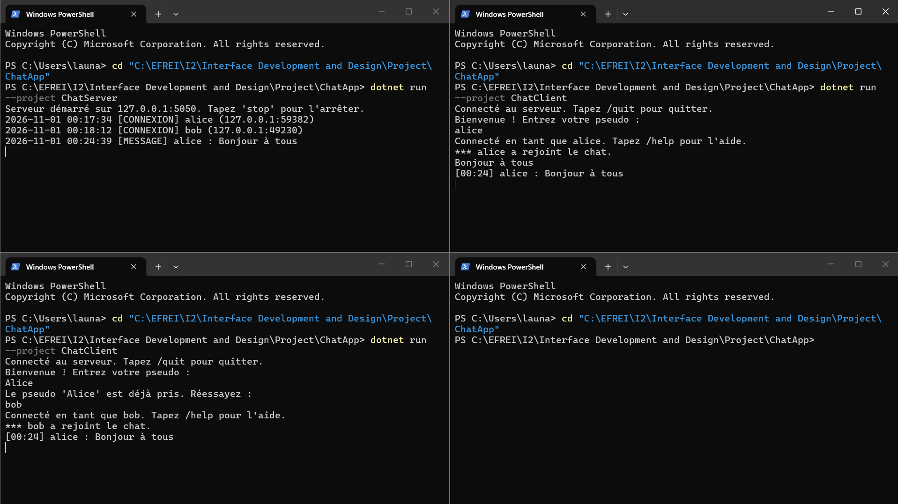
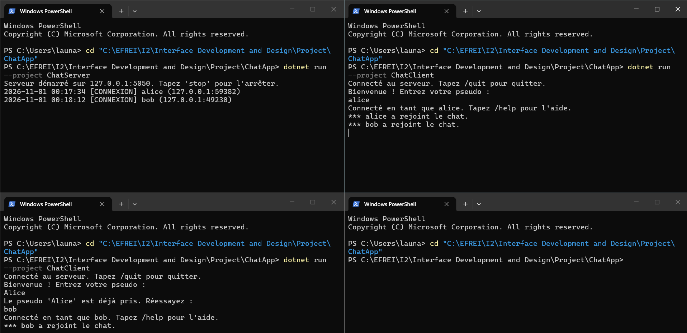
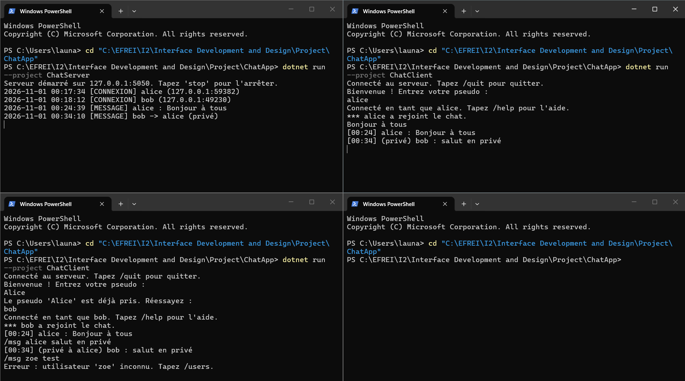
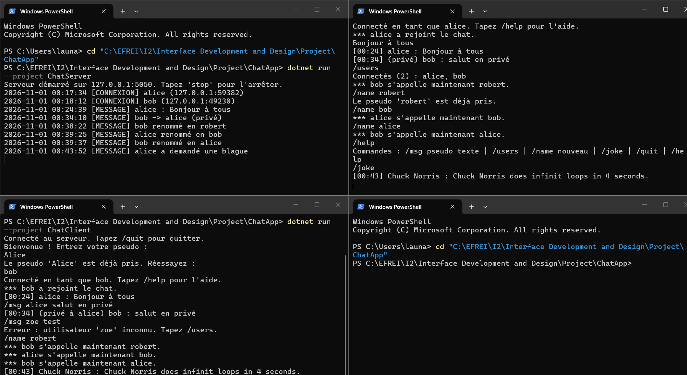
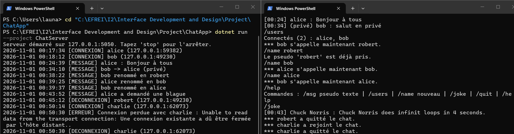

# ChatApp — multi-client TCP chat in C# / .NET 9

A console chat server and client built on raw TCP sockets. Several clients connect to one server, pick a unique nickname, and exchange public messages (broadcast), private messages and commands. The server logs all activity and can call an external HTTP API.

School project (EFREI, *Interface Development and Design*, 2026), done in pairs with Eliott Augay. The course required threads, locks and delegates/events, so the design deliberately uses those rather than `async`/`await` (see [Known limitations](#known-limitations)).



## Features

- **Multi-client server**: one thread per connected client, plus a dedicated accept thread.
- **Unique nicknames**: case-insensitive, 1–20 characters, re-asked until valid and free.
- **Broadcast through a C# event**: every client handler subscribes to the server's `MessageBroadcast` event; one `Invoke` reaches all of them.
- **Commands** (parsed server-side): `/msg`, `/users`, `/name`, `/joke`, `/quit`, `/help`.
- **Logger**: a separate class subscribed to four server events (connection, disconnection, message, error), writing to the console and to `server.log`.
- **Graceful stop**: type `stop` in the server console; clients are warned and disconnected cleanly.
- **External API**: `/joke` fetches a joke from [api.chucknorris.io](https://api.chucknorris.io) with `HttpClient` and `System.Text.Json`, and degrades to an error message if the service is down.
- **Robust client**: handles "server not running", server shutdown and abrupt disconnections.

## Run it

Requires the [.NET 9 SDK](https://dotnet.microsoft.com/download). From the repository root:

```bash
# Terminal 1 — server (listens on 127.0.0.1:5050)
dotnet run --project ChatServer

# Terminals 2, 3, ... — one per client
dotnet run --project ChatClient
```

Each client is asked for a nickname, then everything typed is sent to all connected users. Type `stop` in the server console to shut it down.

## Commands

| Command | Effect |
|---|---|
| *any text* | Sent to everyone, timestamped by the server: `[14:02] alice : hello` |
| `/msg <nick> <text>` | Private message to one user |
| `/users` | List connected users |
| `/name <new>` | Change nickname (refused if taken) |
| `/joke` | Fetch a joke from an external API and share it with everyone |
| `/help` | List commands |
| `/quit` | Leave the chat |

## Architecture

```
ChatServer/
  Program.cs        TcpListener, accept thread, 'stop' console loop
  Server.cs         nickname registry (Dictionary under a lock) + events
  ClientHandler.cs  one per client: login, read loop, commands, Send()
  Logger.cs         subscribes to server events, writes console + server.log
  JokeService.cs    static HttpClient, synchronous call, JSON parsing
ChatClient/
  Program.cs        two threads: keyboard -> server, server -> screen
```

**Protocol.** Plain text, one message per line (`ReadLine` / `WriteLine` with `AutoFlush`). TCP is a byte stream with no message boundaries; using the newline as the delimiter solves the framing problem.

**Threads.**
- Server: 1 main thread (console), 1 accept thread, 1 thread per client. There is no dedicated broadcast thread: the event handlers run on the sender's thread.
- Client: 2 threads, because both `Console.ReadLine` and the network `ReadLine` block.

**Path of a public message.** Client A writes a line → A's handler thread on the server reads it → `Server.Broadcast` raises `MessageBroadcast` → each subscribed `ClientHandler.OnBroadcast` runs, still on A's thread → each writes to its own socket → each client's reading thread prints it.

**Concurrency.**
- The nickname `Dictionary` is only accessed under a private lock in `Server`.
- Each client has its own write lock, because several sender threads can write to the same client at the same time. A per-client lock (instead of one global lock) means a send to Bob never waits for a send to Carol.
- On shutdown, the server copies the client list under the lock, then warns and closes each client **outside** the lock. Closing a client makes its handler run its `finally` block, which calls `Unregister` and takes the same lock; doing this while holding the lock would make the shutdown wait on itself.
- Each handler unsubscribes from the event and unregisters its nickname in a `finally` block, so an abrupt disconnection does not leave a dead subscriber behind.

## Screenshots

| | |
|---|---|
| Login and duplicate nickname  | Private messages  |
| `/joke` (external API)  | Abrupt client disconnection  |

All test captures are in [`docs/screenshots`](docs/screenshots); the full report is [`docs/report.pdf`](docs/report.pdf).

## Known limitations

These are design trade-offs I am aware of, not oversights.

- **One thread per client does not scale.** Each connection costs a thread (≈1 MB of stack) and context switches. Fine for a classroom chat, not for thousands of users. The standard fix is asynchronous I/O (`async`/`await` with `ReadLineAsync`), where a small thread pool serves all connections.
- **Synchronous broadcast: a slow client slows the sender.** The event handlers run on the sender's thread, one after another. If a client stops reading, its TCP buffer fills up and `WriteLine` blocks; the sender's thread is then stuck, and so are the clients after it in the list. Fixes: one outgoing queue per client drained by its own writer (producer/consumer), and/or a write timeout that drops unresponsive clients.
- **`/joke` blocks the requesting client's thread** for up to 5 s (HTTP timeout). Other clients are unaffected.
- **Client display**: on Windows, a message received while the user is typing can be visually overwritten by `Console.ReadLine`. The message is received; only the display is affected. A fix would read keys with `Console.ReadKey` under a lock shared with the network thread.
- **Nickname released slightly late**: after a disconnection, the nickname stays reserved until the handler's `finally` finishes (a few milliseconds), so an immediate re-login with the same name can be refused once.
- **Clients still at the nickname prompt** are not in the registry, so they are not warned on shutdown; their socket closes when the process exits.
- **No automated tests**: scenarios were tested manually (see screenshots).
- **Localhost only**: the server binds to `127.0.0.1:5050`, and messages are in French.
